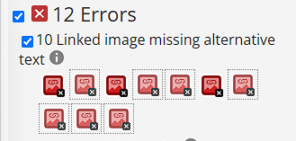
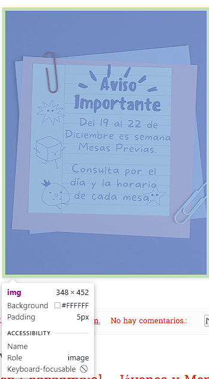
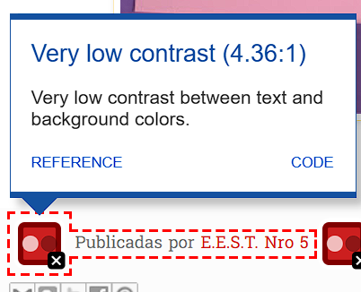

# Informe de auditoría de accesibilidad web

## 1. Datos generales

- **Sitio evaluado:**  Escuela de educacion secundaria tecnica Nro5 
- **URL del sitio:** [EEST5](https://eest5-laplata.blogspot.com/) 
- **Evaluadores:** Santiago Fleitas,Yeny Gamarra,Liz Medina 
- **Fecha de evaluación:** 18/11/2026

## 2. Herramientas utilizadas

Indicar las herramientas empleadas durante la evaluación.

- **Evaluación manual:** Sí 
- **Lighthouse:** Sí 
- **WAVE:** Sí 
- **Otras herramientas:**

## 3. Proceso de evaluación

Describir brevemente cómo se realizó la evaluación.

**Descripcion:**


- Pruebas manuales realizadas.
- Evaluaciones automáticas ejecutadas.
- Contraste entre los resultados manuales y automáticos.
- Procedimiento utilizado para analizar los resultados e identificar los hallazgos.

## 4. Identificación y clasificación de hallazgos

Registrar cada problema identificado durante la evaluación.

- Imagenes sin texto alternativo
- Tablas con titulos vacios 
- Errores de contraste 
- 


### Imagen sin alt

- **Descripción:** Imagenes formativas sin texto alternativo
- **Detección:** Lighthouse, WAVE 
- **Principio(s) POUR relacionado(s):** Perceptible y Operable 
- **Criterio(s) WCAG relacionado(s):** 1.1.1 Non-text Content (Level A) y
2.4.4 Link Purpose (In Context) (Level A)
- **Evidencias:** 






### Errores de contraste
- **Descripción:** Errores de contraste en los texto y fondos 
- **Detección:** Lighthouse, WAVE 
- **Principio(s) POUR relacionado(s):** 
- **Criterio(s) WCAG relacionado(s):** 
- **Evidencias:** 




### Tablas con titulos vacios

- **Descripción:** La tabla se uso como un buscador 
- **Detección:** Lighthouse, WAVE 
- **Principio(s) POUR relacionado(s):** 
- **Criterio(s) WCAG relacionado(s):** 
- **Evidencias:** 

Esta es la tabla que detecta la herramienta de la inspeccion eaccesibilidad Wave,no es visible como tabla sino es usado como un buscador en el sitio 

**Este es el codigo:**

```HTML
<table class="sOblfe" cellpadding="0" cellspacing="0">
    <tbody>
        <tr style="height:20px">
            <td style="width: 24px"><a href="https://www.blogger.com/" title="Ir a Blogger.com" class="QESfS IDE63d"
                    tabindex="0" target="_top"></a></td>
            <td style="width: 150px;">
                <form action="https://eest5-laplata.blogspot.com/search" method="GET" style="display:inline"
                    jsname="UevHkd" target="_top">
                    <div class="bQ1fYb YDEM2">
                        <table cellpadding="0" cellspacing="0">
                            <tbody>
                                <tr>
                                    <td><input name="q" type="text" class="ENqPLc"></td>
                                    <td style="width:15px"><span class="m3Blcf iXjxgf" jsname="SyZOob"
                                            jsaction="click:U067Gf" aria-label="Search" role="button"></span></td>
                                </tr>
                            </tbody>
                        </table>
                    </div>
                </form>
            </td>
            <td style="white-space: nowrap"><select class="L3Qlm PGEEnb IZfeAd jeP7cd" jsname="c4bvtd"
                    jsaction="change:zm3wZe" aria-label="Más opciones">
                    <option value="more" selected="">Más</option>
                    <option value="/email-blog/3086988334646279033">Compartir por correo</option>
                    <option value="/share-blog/3086988334646279033?https=true&amp;target=facebook">Compartir en Facebook
                    </option>
                    <option value="/share-blog/3086988334646279033?https=true&amp;target=twitter">Compartir en Twitter
                    </option>
                    <option value="https://www.blogger.com/report">Denunciar abuso</option>
                </select></td>
            <td class="Lfphtd"><span class="MLeDjd">mail@mail.com</span><a class="PGEEnb IZfeAd"
                    href="https://www.blogger.com/" tabindex="0" target="_top">Escritorio</a><a class="PGEEnb IZfeAd"
                    href="https://eest5-laplata.blogspot.com/"
                    tabindex="0" target="_top">Cerrar sesión</a></td>
        </tr>
    </tbody>
</table>
```

**Componente visual:**


## 5. Observaciones finales

Registrar aspectos relevantes del proceso de evaluación, como pruebas que no pudieron realizarse, limitaciones de las herramientas o resultados que requieren verificación adicional.

Los hallazgos documentados en este informe servirán como base para elaborar el plan de remediación.